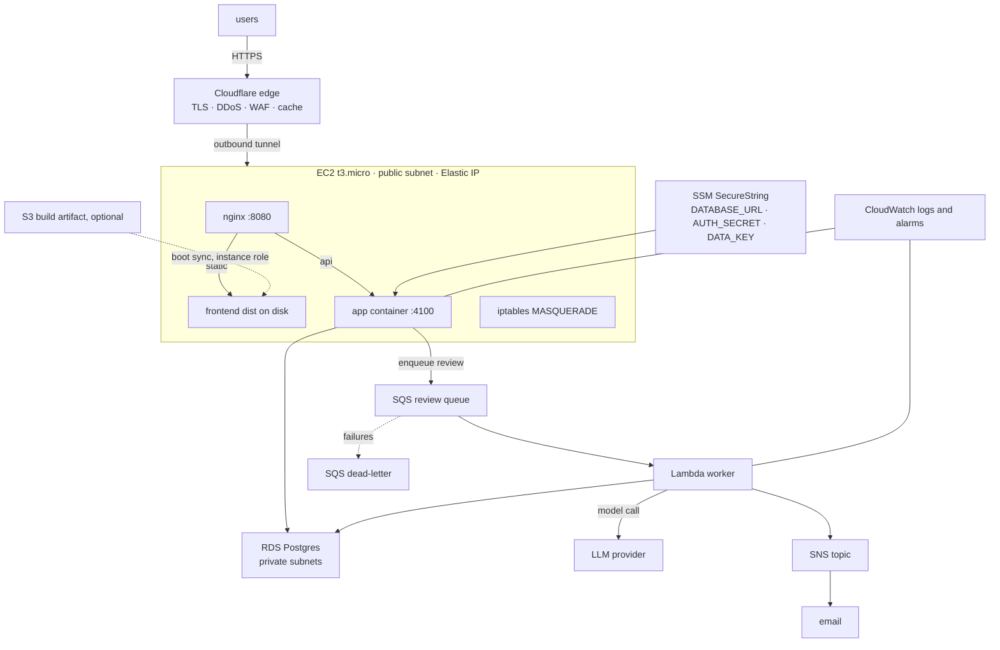

# AWS

One small EC2 instance does ingress termination, static hosting, the API, and NAT for the private subnets. Cloudflare's tunnel puts it on the internet with no inbound port open. No load balancer, no NAT gateway, no certificate, no CloudFront.

## What each piece does

| Piece | Job | Cost |
|---|---|---|
| Cloudflare edge and Tunnel | public entry, TLS, DDoS, WAF, caching | free |
| EC2 `t3.micro` | cloudflared, nginx, the app container, NAT for the private subnets | inside the free plan or credits, about $8 paid |
| Elastic IP | stable source address for the NAT | free while attached |
| RDS Postgres `db.t4g.micro` 20GB | resumes, reviews, accounts | inside the free plan or credits, about $15 paid |
| SSM parameter store | `DATABASE_URL`, `AUTH_SECRET`, `DATA_KEY`, tunnel token, and the RDS password inside the first of those. Also Session Manager for a shell with no port 22, and Patch Manager for the box | standard parameters free |
| SQS | review jobs, with a dead-letter queue for the ones that fail | free tier covers 1M requests |
| Lambda | the review worker that consumes the queue | free tier |
| SNS | where alarms and Budgets notifications arrive | pennies |
| CloudWatch | logs, an alarm on 5xx and instance status, a dashboard, and an EventBridge cron that curls the public hostname every five minutes | cents |
| S3, optional | the built frontend, pulled at boot by the instance role | cents |
| ECR | the app image | 500MB free on the 12-month model, cents above |
| Budgets | spend guardrail | first two are free |

Free tier depends on account age. Accounts from before July 15, 2025 keep the 12-month allowances. Accounts after that date get $200 of credits for six months, then a paid plan. Either way this shape fits, because the two expensive defaults are absent.

## IAM

Two roles, no users, no access keys. Every ARN is scoped to the one queue, topic, repository and parameter prefix.

| Principal | Permissions | For |
|---|---|---|
| EC2 instance role | `AmazonSSMManagedInstanceCore` | Session Manager shell with no port 22 open, Patch Manager |
| | `ssm:GetParameter`, `ssm:GetParameters`, `kms:Decrypt` on `alias/aws/ssm` | reading the SecureString parameters. The decrypt permission is the one that gets forgotten |
| | `ecr:GetAuthorizationToken`, `ecr:BatchGetImage`, `ecr:GetDownloadUrlForLayer` on the app repository | pulling the image |
| | `sqs:SendMessage` on the review queue | enqueue from the API |
| | `logs:CreateLogStream`, `logs:PutLogEvents` | container logs |
| Lambda execution role | `sqs:ReceiveMessage`, `sqs:DeleteMessage`, `sqs:ChangeMessageVisibility`, `sqs:GetQueueAttributes` on the queue | draining it |
| | `ssm:GetParameter`, `ssm:GetParameters`, `kms:Decrypt` on `alias/aws/ssm` | `DATABASE_URL` for the write back |
| | `logs:CreateLogStream`, `logs:PutLogEvents` | its own logs |
| | `sns:Publish` on the topic | the completion mail |
| GitHub Actions | none while it pushes to GHCR. Moving to ECR means an OIDC role scoped to that repository | no long-lived keys |
| RDS | none | `rds-monitoring-role` only with Enhanced Monitoring |

## What is deliberately absent

| Not used | Why |
|---|---|
| ACM | the certificate is Cloudflare's, nothing in AWS terminates TLS |
| CloudFront and OAC | Cloudflare is the CDN; OAC exists only to let CloudFront read a private bucket |
| ALB | about $16 a month, and the tunnel already provides the front door |
| NAT gateway | about $32 a month, the instance does the same job |
| API Gateway | unnecessary once the tunnel and nginx are there |

## Caching

| Path | Rule | Reason |
|---|---|---|
| `/assets/*` | cache, long edge TTL, a year in the browser, immutable | vite fingerprints those filenames |
| `/` and `*.html` | bypass cache | a cached shell is a stale deploy |
| `/api/*` | bypass cache | session cookies, POSTs, per-user data |

`frontend/nginx.conf` already sends `public, max-age=31536000, immutable` for `/assets/` and `no-store` for `index.html`, so the origin agrees with the rules. Cloudflare also refuses to cache a response carrying `Set-Cookie`.

## The async review, and why Lambda earns its place

`POST /resumes/:id/review` currently holds the request open while the model writes, which is the shape that dies on a timeout. With a queue the API answers immediately, the worker retries, the dead-letter queue keeps the failures, and SNS can announce completion. That is one PR-sized change here: a job row, a status endpoint, a worker handler, and the frontend polling instead of awaiting.

It also gives SQS, SNS, Lambda, CloudWatch and IAM real work. The alternative, putting the whole API on Lambda, buys nothing once the instance is already running, and it costs the in-process rate limiter its meaning.

## Traps

- 100 second origin timeout on the free Cloudflare plan. A cold compile must finish inside it or the user sees a 524.
- 100MB upload cap, far above the 2MB PDF limit.
- The tunnel token is a credential: SSM SecureString, injected at boot, never in user data or a repo.
- One box, one AZ. A reboot takes down ingress and egress together. Alarm on it rather than pretending it is resilient.
- Rotating `DATA_KEY` would require re-sealing every row, so keep it out of any rotation policy.
- The RDS password is part of `DATABASE_URL` in SSM, and nothing rotates it on a schedule. Changing it means `ALTER ROLE` and a parameter update by hand.

## Deploy order

1. VPC with one public subnet and two private ones, internet gateway, route tables. Point the private table at the gateway once it exists.
2. RDS in the private subnets, single-AZ, not publicly accessible, 5432 open only to the gateway.
3. SSM SecureString parameters: `DATABASE_URL`, `AUTH_SECRET`, `DATA_KEY`, tunnel token.
4. ECR repository, push the app image.
5. EC2 `t3.micro` with an Elastic IP and a role for SSM read, ECR pull, SQS send, CloudWatch logs. Source/destination check off. User data installs docker, cloudflared and nginx.
6. Cloudflare: tunnel, public hostname to `http://localhost:8080`, cache rules above, WAF on, optional Access.
7. SQS queue and dead-letter queue, the worker Lambda, the SNS topic and its email subscription.
8. Migrations once from the instance, then alarms, Budgets, and the five-minute probe.
9. Smoke: page loads, `/api/healthz` ok, sign in, save a resume, open the preview, reload `/login` directly, enqueue a review and watch it land.

## Tune after measuring

Watch nginx request times and the compile duration in the logs. Order of work once numbers exist: cache compiled PDFs under `sha256(text)`, lazy-load `pdfjs-dist` in `extractPdf`, then decide whether the compile deserves its own host. Do not split anything before a number says it hurts.
