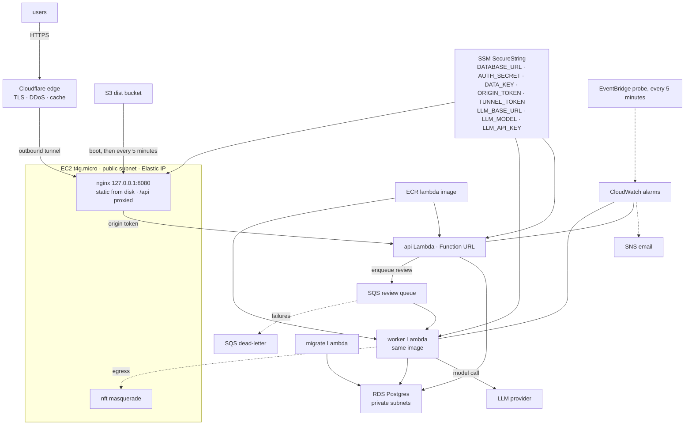

# AWS

## IAM

Two roles for AWS services, one for CI, no users, no access keys. Every ARN is scoped to the one queue, bucket, repository and parameter prefix.

| Principal             | Permissions                                                                                                     | For                                                                                        |
| --------------------- | --------------------------------------------------------------------------------------------------------------- | ------------------------------------------------------------------------------------------ |
| EC2 instance role     | `AmazonSSMManagedInstanceCore`                                                                                  | Session Manager shell with no port 22 open, Patch Manager                                  |
|                       | `ssm:GetParameter`, `ssm:GetParameters`, `kms:Decrypt` on `alias/aws/ssm`                                       | the tunnel and origin tokens at boot. The decrypt permission is the one that gets forgotten |
|                       | `s3:GetObject`, `s3:ListBucket` on the dist bucket                                                              | the five minute sync, so a frontend deploy needs no reboot                                 |
| Lambda execution role | `ssm:GetParameter`, `ssm:GetParameters`, `kms:Decrypt` on `alias/aws/ssm`                                       | the app config at cold start, read by `backend/src/bootstrap.ts`                           |
|                       | `ecr:GetAuthorizationToken`, `ecr:BatchCheckLayerAvailability`, `ecr:BatchGetImage`, `ecr:GetDownloadUrlForLayer` | the service pulling the image                                                              |
|                       | `sqs:ReceiveMessage`, `sqs:DeleteMessage`, `sqs:ChangeMessageVisibility`, `sqs:GetQueueAttributes` on the queue | draining it                                                                                |
|                       | `logs:CreateLogStream`, `logs:PutLogEvents`                                                                     | its own logs                                                                               |
| GitHub Actions        | `sts:AssumeRoleWithWebIdentity`, restricted to `refs/heads/main` of the sesume repository                        | no long-lived keys                                                                         |
|                       | `ecr` push on the lambda repository, `s3:PutObject`, `s3:DeleteObject`, `s3:ListBucket` on the dist bucket    | the image and the built frontend                                                           |
|                       | `lambda:UpdateFunctionCode`, `lambda:GetFunction`, `lambda:GetFunctionConfiguration` on `sesume-*`                | rolling the image without an apply                                                         |
|                       | `lambda:InvokeFunction` on the migration function                                                               | running the pending migrations before the API rolls, and failing the run when one fails    |
| RDS                   | none                                                                                                            | `rds-monitoring-role` only with Enhanced Monitoring                                        |

## What is deliberately absent

| Not used           | Why                                                                            |
| ------------------ | ------------------------------------------------------------------------------ |
| ACM                | the certificate is Cloudflare's, nothing in AWS terminates TLS                 |
| CloudFront and OAC | Cloudflare is the CDN; OAC exists only to let CloudFront read a private bucket |
| ALB                | about $16 a month, and the tunnel already provides the front door              |
| NAT gateway        | about $32 a month, the instance does the same job                              |
| API Gateway        | unnecessary once the tunnel and nginx are there                                |
